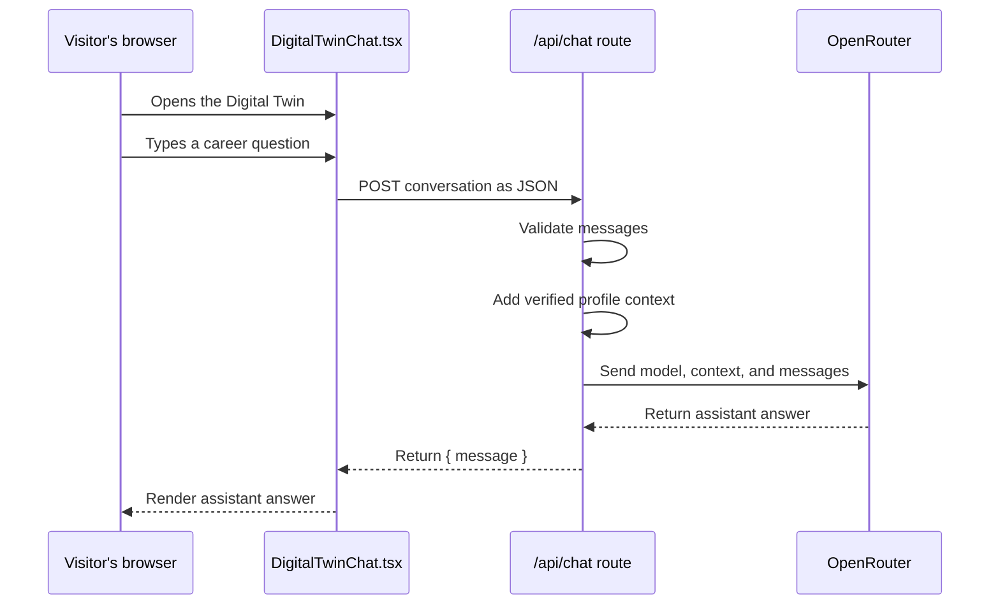

# Building Yash Goyal's Professional Website

This tutorial explains the professional website in this project from the ground up. It is written for someone who is new to frontend development and wants to understand not only what the code does, but also why it is structured this way.

The project is a professional profile website for Yash Goyal. It contains:

- A polished, responsive personal website.
- An about section describing Yash's focus and technical strengths.
- A career journey section based on the supplied profile and resume.
- A selected-work section featuring the CoinPulse project.
- Contact links for email, LinkedIn, and phone.
- A Digital Twin chat that answers career questions using OpenRouter and the `openai/gpt-oss-120b` model.

The website is available locally at `http://localhost:3000` when the development server is running.

## 1. Technology Summary

### Next.js

Next.js is a framework built on top of React. React helps us build interfaces from reusable components. Next.js adds useful application features such as:

- File-based routing.
- Server-rendered pages.
- API route handlers.
- Production builds and optimizations.
- A standard project structure for larger applications.

This project uses the Next.js App Router. The `app` folder is the main application boundary.

### React

React lets us describe the interface as a tree of components. Instead of manually finding HTML elements and changing them, we describe what the interface should look like for the current state.

For example, the Digital Twin chat has two important states:

```text
closed chat -> show the "Ask my twin" button
open chat   -> show the button and the chat panel
```

React updates the page when that state changes.

### TypeScript

TypeScript is JavaScript with type checking. It helps catch mistakes before the application runs.

This type describes a message used by the chat:

```ts
type Message = {
  role: 'user' | 'assistant';
  content: string;
};
```

The `role` field can only be either `user` or `assistant`. The `content` field must be text.

### CSS

The visual design lives in `app/globals.css`. It defines:

- Colors such as the dark green, pale background, and acid green accent.
- Typography using Manrope and DM Mono.
- The hero composition and orbit artwork.
- Layout grids and spacing.
- Responsive behavior for smaller screens.
- The Digital Twin panel, messages, buttons, and animations.

The website uses plain CSS rather than a component library. This keeps the visual language easy to inspect and customize.

### OpenRouter

OpenRouter provides an HTTP API for sending chat messages to language models. The server calls:

```text
https://openrouter.ai/api/v1/chat/completions
```

The selected model is:

```text
openai/gpt-oss-120b
```

The API key is stored in the project root `.env` file under `OPENROUTER_API_KEY`. The key is read only by the server route. It is never placed in browser code.

## 2. Project Structure

The important files are:

```text
site/
├── app/
│   ├── api/
│   │   └── chat/
│   │       └── route.ts
│   ├── components/
│   │   └── DigitalTwinChat.tsx
│   ├── globals.css
│   ├── layout.tsx
│   └── page.tsx
├── .env
├── next.config.mjs
├── package.json
├── tsconfig.json
└── tutorial.md
```

### `app/page.tsx`

This is the main page. It renders the navigation, hero section, about section, journey, selected work, footer, and Digital Twin component.

### `app/components/DigitalTwinChat.tsx`

This is the interactive browser component. It opens and closes the chat, stores messages, sends requests, displays loading state, and handles errors.

### `app/api/chat/route.ts`

This is a server-side API endpoint. It validates incoming chat messages, adds Yash's profile context, calls OpenRouter, and sends the assistant's answer back to the browser.

### `app/layout.tsx`

This is the shared document layout. It sets the page metadata and imports the global stylesheet.

### `app/globals.css`

This contains the global design system and all page styles.

## 3. Running the Project

You need Node.js and npm installed.

From the project folder, install dependencies:

```powershell
npm install
```

Start the development server:

```powershell
npm run dev
```

Then open:

```text
http://localhost:3000
```

To create a production build:

```powershell
npm run build
```

To run the production build after building:

```powershell
npm run start
```

## 4. Environment Variables

The Digital Twin needs an OpenRouter API key. The root `.env` file contains:

```env
OPENROUTER_API_KEY=your-secret-key
```

Never commit a real API key to GitHub. The `.env` file should be ignored by Git. A public frontend variable usually begins with `NEXT_PUBLIC_`, but this key must **not** use that prefix. A `NEXT_PUBLIC_` value can be included in browser JavaScript, which would expose the secret.

The safe flow is:

```text
Browser -> local /api/chat route -> OpenRouter
```

The unsafe flow would be:

```text
Browser -> OpenRouter using the secret key
```

The second flow would allow anyone inspecting the browser to steal the key.

## 5. How the Page Is Built

The page stores repeated career data in arrays instead of writing every item separately.

```tsx
const journey = [
  {
    year: 'Jun 2026 — now',
    title: 'Data Engineer Trainee · Suzuki Digital',
    copy: 'Developing enterprise applications for Suzuki dealers, service teams, and customers with Next.js, NestJS, and TypeScript.',
  },
  {
    year: 'Feb — Jun 2026',
    title: 'Data Engineer Trainee · Nagarro',
    copy: 'Built scalable data pipelines with Python, SQL, Databricks, and Azure Cloud.',
  },
];
```

The page then maps over the array:

```tsx
<div className="timeline">
  {journey.map((item, index) => (
    <article className="timeline-item" key={item.year}>
      <div className="timeline-year">{item.year}</div>
      <div className="timeline-dot">0{index + 1}</div>
      <div>
        <h3>{item.title}</h3>
        <p>{item.copy}</p>
      </div>
    </article>
  ))}
</div>
```

### What `map` means

`map` takes every item in an array and creates a new piece of UI for it. If the array has three career items, React creates three `<article>` elements.

The `key` prop gives React a stable identity for each item. It helps React update lists efficiently.

### What JSX means

JSX is the HTML-like syntax used inside React components. It allows JavaScript expressions inside braces:

```tsx
<p>{item.copy}</p>
```

The value of `item.copy` becomes the text inside the paragraph.

## 6. The Shared Layout

The layout file sets metadata and loads the global CSS:

```tsx
import type { Metadata } from 'next';
import './globals.css';

export const metadata: Metadata = {
  title: 'Yash Goyal | Enterprise Technology & Strategy',
  description: 'The professional profile of Yash Goyal.',
};

export default function RootLayout({
  children,
}: Readonly<{ children: React.ReactNode }>) {
  return (
    <html lang="en">
      <body>{children}</body>
    </html>
  );
}
```

`children` means "whatever page is currently being rendered inside this layout." This makes `layout.tsx` useful for shared document structure.

The `Metadata` type comes from Next.js and helps ensure the metadata has the right shape.

## 7. The Digital Twin Client Component

The Digital Twin is interactive, so it begins with:

```tsx
'use client';
```

This directive tells Next.js that the component needs to run in the browser. It is required because the component uses state, event handlers, and `fetch` from the browser.

### Component state

```tsx
const [open, setOpen] = useState(false);
const [messages, setMessages] = useState<Message[]>([starterMessage]);
const [input, setInput] = useState('');
const [loading, setLoading] = useState(false);
```

Each state value has a different responsibility:

- `open` controls whether the panel is visible.
- `messages` stores the conversation currently shown on screen.
- `input` stores the text currently inside the input field.
- `loading` prevents duplicate requests and shows the typing indicator.

`useState(false)` returns two things: the current value and a function that changes it. For example:

```tsx
setOpen(true);
```

opens the panel.

### Opening and closing the panel

```tsx
<button
  type="button"
  onClick={() => setOpen(!open)}
  aria-expanded={open}
  aria-controls="digital-twin-panel"
>
  {open ? 'Close twin' : 'Ask my twin'}
</button>
```

The click handler changes `open` to the opposite of its current value. The text changes with a conditional expression:

```tsx
open ? 'Close twin' : 'Ask my twin'
```

The accessibility attributes help screen readers understand the relationship between the button and the panel.

## 8. Sending a Chat Message

The main interaction happens inside `sendMessage`:

```tsx
async function sendMessage(event?: FormEvent, suggested?: string) {
  event?.preventDefault();
  const content = (suggested ?? input).trim();
  if (!content || loading) return;

  const nextMessages = [
    ...messages,
    { role: 'user' as const, content },
  ];

  setMessages(nextMessages);
  setInput('');
  setLoading(true);
```

### Step-by-step explanation

1. `event?.preventDefault()` stops a form submission from refreshing the page. The `?.` operator means this is safe even when the function is called by a suggested question instead of a form event.
2. `suggested ?? input` uses the suggested question if one was provided. Otherwise it uses the input field.
3. `trim()` removes extra whitespace.
4. Empty messages and duplicate requests are rejected.
5. A new user message is added to the existing conversation.
6. The input is cleared and the loading state begins.

The request is sent to our own Next.js route:

```tsx
const response = await fetch('/api/chat', {
  method: 'POST',
  headers: { 'Content-Type': 'application/json' },
  body: JSON.stringify({
    messages: nextMessages.filter(
      (message) => message !== starterMessage
    ),
  }),
});
```

The request uses `POST` because it sends data to the server. The JSON body contains the conversation history.

The starter message is displayed to the visitor, but it is not sent as if it were an actual assistant response from the model.

After the server responds, the answer is added to the conversation:

```tsx
const result = await response.json() as {
  message?: string;
  error?: string;
};

setMessages([
  ...nextMessages,
  {
    role: 'assistant',
    content: result.message ?? result.error ?? 'I could not answer that right now.',
  },
]);
```

The `??` operator provides a fallback when a value is missing.

The `finally` block always turns off loading, whether the request succeeds or fails:

```tsx
finally {
  setLoading(false);
}
```

## 9. The Server API Route

The file `app/api/chat/route.ts` becomes the endpoint `/api/chat` because of Next.js file-based routing.

The route exports a `POST` function:

```ts
export async function POST(request: Request) {
  try {
    const body = await request.json() as {
      messages?: ChatMessage[];
    };

    // Validation and OpenRouter call happen here.
  } catch {
    return NextResponse.json(
      { error: 'The Digital Twin is temporarily unavailable.' },
      { status: 500 }
    );
  }
}
```

Next.js calls this function whenever the browser sends a `POST` request to `/api/chat`.

### Validating messages

The route does not blindly trust browser input:

```ts
const messages = incomingMessages
  .filter(
    (message) =>
      (message.role === 'user' || message.role === 'assistant') &&
      typeof message.content === 'string'
  )
  .slice(-12)
  .map((message) => ({
    role: message.role,
    content: message.content.trim().slice(0, 4000),
  }))
  .filter((message) => message.content.length > 0);
```

This does several useful things:

- Accepts only the two roles that the application understands.
- Keeps only the most recent 12 messages.
- Limits each message to 4,000 characters.
- Removes empty messages.

Limiting history helps control token usage and prevents a visitor from sending an unnecessarily large request.

The route also checks that the final message is from the user:

```ts
if (!messages.length || messages[messages.length - 1].role !== 'user') {
  return NextResponse.json(
    { error: 'A user message is required.' },
    { status: 400 }
  );
}
```

HTTP status `400` means the browser sent an invalid request.

### Adding the Digital Twin profile

The route contains a `profileContext` string describing Yash's education, roles, skills, projects, and achievements. It is sent as a system message before the conversation:

```ts
body: JSON.stringify({
  model: 'openai/gpt-oss-120b',
  messages: [
    { role: 'system', content: profileContext },
    ...messages,
  ],
  temperature: 0.5,
  max_tokens: 500,
}),
```

The system message gives the model its behavior and source material. The conversation messages follow it.

The profile instructions tell the model to:

- Answer career-related questions.
- Speak warmly and concisely.
- Avoid inventing information.
- Admit when a detail is not available.
- Avoid claiming to be the real Yash.

### Calling OpenRouter

The server reads the secret key:

```ts
const apiKey = process.env.OPENROUTER_API_KEY;

if (!apiKey) {
  return NextResponse.json(
    { error: 'The Digital Twin is not configured yet.' },
    { status: 500 }
  );
}
```

Then it calls OpenRouter:

```ts
const response = await fetch(
  'https://openrouter.ai/api/v1/chat/completions',
  {
    method: 'POST',
    headers: {
      Authorization: `Bearer ${apiKey}`,
      'Content-Type': 'application/json',
      'HTTP-Referer': 'http://localhost:3000',
      'X-Title': 'Yash Goyal Digital Twin',
    },
    body: JSON.stringify({
      model: 'openai/gpt-oss-120b',
      messages: [
        { role: 'system', content: profileContext },
        ...messages,
      ],
      temperature: 0.5,
      max_tokens: 500,
    }),
    signal: AbortSignal.timeout(30000),
    cache: 'no-store',
  }
);
```

Important parts:

- `Authorization` sends the secret to OpenRouter over HTTPS.
- `model` selects the requested model.
- `temperature` controls creativity. A value of `0.5` keeps career answers fairly focused.
- `max_tokens` limits response size.
- `AbortSignal.timeout(30000)` stops waiting after 30 seconds.
- `cache: 'no-store'` prevents the request from being treated as a cacheable response.

The route does not log the API key or return it to the browser.

### Reading the model response

OpenRouter returns a chat-completion-shaped response. The route extracts the first answer:

```ts
const result = await response.json() as {
  choices?: Array<{
    message?: { content?: string };
  }>;
};

const answer = result.choices?.[0]?.message?.content?.trim();
```

Optional chaining (`?.`) prevents the application from crashing if part of the response is missing.

If the answer is valid, the server sends a small JSON response back to the browser:

```ts
return NextResponse.json({ message: answer });
```

The browser receives:

```json
{
  "message": "Yash currently works on enterprise applications..."
}
```

## 10. Rendering the Conversation

The component loops over the messages:

```tsx
{messages.map((message, index) => (
  <div
    className={`twin-message ${message.role}`}
    key={`${message.role}-${index}`}
  >
    <span>
      {message.role === 'assistant'
        ? displayAnswer(message.content)
        : message.content}
    </span>
  </div>
))}
```

The role becomes part of the CSS class. That lets user messages and assistant messages have different colors and alignment.

The small `displayAnswer` function removes common Markdown markers from model output:

```ts
function displayAnswer(content: string) {
  return content
    .replace(/\*\*/g, '')
    .replace(/(^|\n)\s*\*\s/g, '$1• ');
}
```

This is deliberately simple. It is not a complete Markdown renderer; it just keeps typical model responses readable in the current design.

While a request is running, the component displays three animated dots:

```tsx
{loading && (
  <div className="twin-message assistant">
    <span className="twin-typing">
      <i />
      <i />
      <i />
    </span>
  </div>
)}
```

The CSS animation moves each dot at a slightly different time, creating a typing effect.

## 11. Responsive Design

The main stylesheet uses a desktop-first layout and a media query for narrow screens:

```css
@media (max-width: 760px) {
  .nav-links {
    display: none;
  }

  .hero {
    display: block;
  }

  .about-grid {
    display: block;
  }

  .twin-panel {
    right: 18px;
    bottom: 70px;
    width: calc(100vw - 36px);
  }
}
```

On mobile:

- Desktop navigation links are hidden to preserve space.
- Grid sections become single-column layouts.
- Heading sizes shrink using `clamp`.
- The chat panel fits inside the viewport.
- The launcher moves closer to the screen edges.

The `calc(100vw - 36px)` expression gives the panel a 18px margin on each side.

## 12. A Practical Beginner Debugging Flow

When changing this project, use this sequence:

1. Make one small change.
2. Save the file.
3. Look at the browser at `http://localhost:3000`.
4. Check the terminal for compile errors.
5. Run `npm run build` before considering the change finished.

For the chat specifically:

1. Open the Digital Twin panel.
2. Ask a suggested question.
3. Open the browser Network tab and find `/api/chat`.
4. Confirm it returned status `200`.
5. Confirm the response contains a `message` field.
6. If it fails, check that `.env` contains `OPENROUTER_API_KEY` and restart the development server.

Never paste the actual API key into browser code, screenshots, chat messages, or a public repository.

## 13. What Happens During One Chat Request

Here is the complete flow:



## 14. Self-Review: Five Ways to Improve the Code

The current implementation works, but a self-review identifies several improvements for a production version.

### 1. Stream the assistant response

The current route waits for the complete OpenRouter response before showing anything. Streaming would let visitors see the answer as it is generated, reducing the perceived wait time.

Possible approach:

- Request a streaming response from OpenRouter.
- Return a `ReadableStream` from the route.
- Read the stream in the client and append partial text to the latest assistant message.

### 2. Add request rate limiting

The endpoint currently validates size, but it does not limit how often one visitor can call it. A public deployment could receive excessive requests and incur unnecessary model costs.

Possible improvements include:

- IP-based rate limiting.
- A hosted rate-limit service such as Upstash Redis.
- A per-session request counter.
- A visible daily usage budget.

### 3. Move profile data into a separate content file

The profile context is currently a long string inside `route.ts`. That works, but content and application logic are mixed together.

A clearer structure could be:

```text
content/
└── yash-profile.ts
```

The route could import the profile from that file. This would make updates to roles, projects, and skills easier without editing API logic.

### 4. Use a real Markdown renderer or structured response format

`displayAnswer` only removes a few common Markdown markers. It does not support links, headings, code blocks, or nested lists.

A stronger solution would either:

- Use a trusted Markdown renderer with sanitization.
- Ask the model for a structured JSON response.
- Restrict the model to plain text and handle paragraphs explicitly.

If HTML is ever rendered from model output, it must be sanitized to reduce XSS risk.

### 5. Add automated tests

The main verification today is the production build and a live browser request. A mature version should add automated tests for:

- Rejecting an empty message.
- Rejecting an invalid role.
- Limiting conversation history.
- Handling a missing API key.
- Handling an OpenRouter error.
- Rendering the chat open and closed.
- Showing a successful assistant response.

The route could be tested with mocked `fetch` responses so tests do not spend real API credits.

## Final Mental Model

Think of the application as three layers:

```text
Presentation layer
  page.tsx + globals.css
  Shows the professional profile and visual design.

Interaction layer
  DigitalTwinChat.tsx
  Stores messages and talks to the local API route.

Server/integration layer
  api/chat/route.ts
  Protects the key, validates input, adds profile context, and calls OpenRouter.
```

The most important boundary is between the browser and the server. The browser is allowed to know about the chat interface. Only the server is allowed to know the OpenRouter secret.
